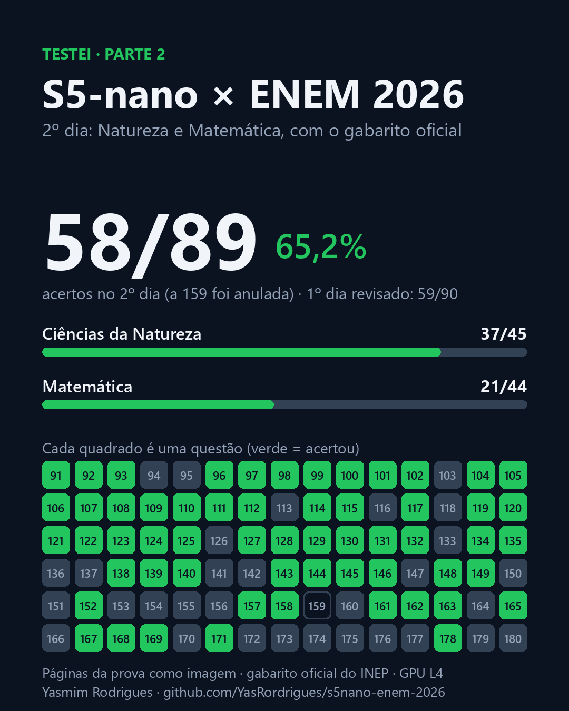
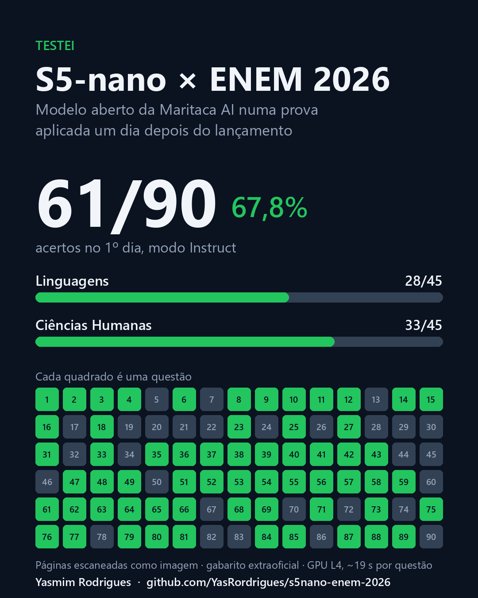

# S5-nano no ENEM 2026: o modelo brasileiro numa prova que ele nunca viu

A Maritaca AI abriu os pesos do S5-nano (cerca de 4B de parâmetros, Apache 2.0) em 07/11/2026, e as provas do ENEM 2026 foram aplicadas logo depois, em 08/11 e 15/11. Resultados em provas antigas do ENEM podem estar inflados, porque as questões já circulam na internet e podem ter entrado no treino. Uma prova aplicada depois do lançamento não tem esse problema, então quis ver como o modelo se sai nela.

*Testing Maritaca's new open Brazilian model on the ENEM 2026 exam held the day after its release, so it can't have seen the questions.*

## Como funciona

- O modelo recebe as **páginas do caderno azul como imagem**, sem transcrição.
- 1º dia: 45 questões de Linguagens (nas questões 01 a 05, a opção de inglês) e 45 de Ciências Humanas.
- 2º dia: 45 de Ciências da Natureza e 45 de Matemática. A questão 159 foi anulada pelo INEP e fica de fora.
- Correção pelo **gabarito oficial do INEP**.
- Um OCR (Tesseract) só localiza em que página está cada "QUESTÃO NN"; quem lê o enunciado e responde é o modelo.
- Prompt único em português pedindo um raciocínio curto e a linha final `Resposta: X`.
- Parâmetros de amostragem recomendados no model card (Instruct: temperature 0.7, top_p 0.8, top_k 20).

## Resultados

Modo Instruct, 1 rodada por dia, GPU L4 no Colab (bf16), gabarito oficial do INEP.

| | Acertos |
|---|---|
| **Total dos dois dias** | **117/179 (65,4%)** |
| 1º dia | 59/90 (65,6%) |
| Linguagens | 28/45 |
| Ciências Humanas | 31/45 |
| 2º dia | 58/89 (65,2%) |
| Ciências da Natureza | 37/45 |
| Matemática | 21/44 |

### 2º dia

- Em 19 questões (18 de Matemática e a 116) o modelo chegou ao limite de 2048 tokens ainda fazendo contas e não escreveu a resposta; elas contam como erro. Nas 26 questões de Matemática em que respondeu, acertou 21.
- O OCR achou o cabeçalho das 90 questões.
- Média de 57 s por questão (Natureza perto de 30 s; Matemática bem mais, por causa das contas).

### 1º dia

- O post e o card do 1º dia usaram o gabarito extraoficial da Plataforma Assaad (61/90). Com o oficial do INEP o resultado é 59/90: o oficial deu C na 48 (o extraoficial aceitava C ou D) e B na 71, e o modelo tinha respondido D e A.
- Em 5 questões (07, 21, 70, 72 e 74) o modelo estourou o limite de 1024 tokens antes de escrever a resposta; elas contam como erro.
- O 1º dia rodou com o caderno escaneado publicado pelo Diário do Nordeste (o OCR achou 84 das 90 questões; nas outras 6 o modelo recebeu as páginas vizinhas).
- Para comparar: o model card da Maritaca reporta 78,57% no modo Instruct no ENEM-VL, com outras provas e outro formato.

## Limitações

- Ler a página inteira é mais difícil do que receber a questão em texto, então o teste mede leitura da prova e raciocínio juntos. Os números da Maritaca no model card usam outro formato e outras provas, então não são diretamente comparáveis.
- Uma rodada só, com amostragem: uma ou duas questões de diferença é ruído.
- Em Matemática, um limite maior de tokens ou o modo Think provavelmente mudaria o resultado; aqui ficou o mesmo modo Instruct dos dois dias.

## Rodar

Abra o notebook no Colab com GPU (T4 ou L4), escolha o dia em `DIA` na primeira célula e execute tudo. Os PDFs oficiais do INEP (prova e gabarito do caderno azul) estão na pasta `provas/`, porque o site do INEP não responde a downloads vindos do Colab.

## Créditos

- [maritaca-ai/S5-nano](https://huggingface.co/maritaca-ai/S5-nano)
- Provas e gabaritos oficiais: [INEP](https://www.gov.br/inep/pt-br/areas-de-atuacao/avaliacao-e-exames-educacionais/enem/provas-e-gabaritos)
- Caderno do 1º dia usado na primeira rodada: [Diário do Nordeste](https://diariodonordeste.verdesmares.com.br/ceara/enem-2026-baixe-caderno-completo-e-veja-todas-as-questoes-do-1-dia-1.3804325), cópia em [FII Brasil](https://fiibrasil.com/noticia/gabarito-enem-2026-extraoficial-primeiro-dia-cores-provas/)
- Gabarito extraoficial: [Plataforma Assaad](https://plataformaassaad.com.br/gabarito-enem-2026/)
